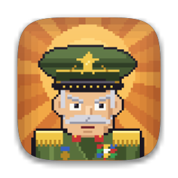
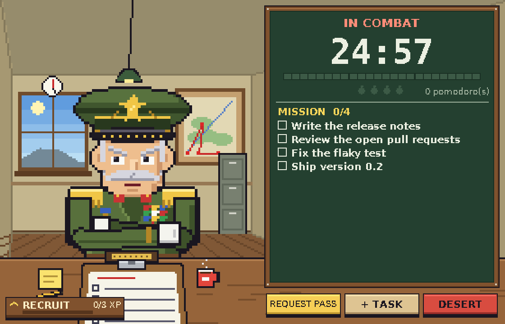
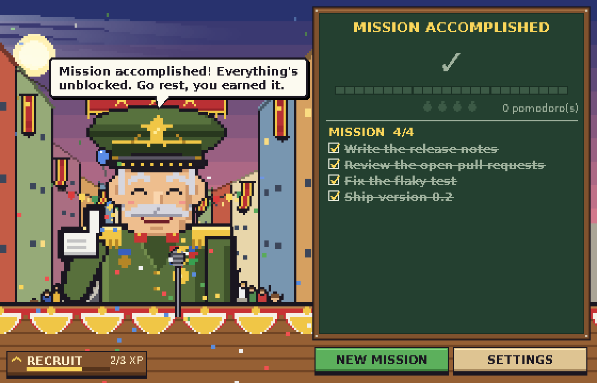

<p align="center">
  
</p>

<h1 align="center">Tenhut</h1>

<p align="center">
  <em>"Ten-hut!" — the military command for <strong>Attention!</strong></em><br>
  An aggressive pomodoro: a pixel-art general watches you work and blocks every distraction until the mission is done.
</p>

<p align="center">
  <a href="https://github.com/eljonathas/tenhut/actions/workflows/ci.yml"></a>
  <a href="LICENSE"></a>
  
  
</p>

<p align="center">
  
  
</p>

[Português](README.pt-BR.md)

## What it does

You write the tasks for your mission and start the clock. For the whole work block the general stares at you
(from your point of view, across his desk) and the sites that usually eat your time are blocked. They come back
during breaks, and for good when **every task is checked off**.

- **Aggressive pomodoro.** 25 / 5 / 15 minutes by default, with a long break every 4 cycles. All of it is configurable.
- **A judge for your excuses.** Need YouTube for a tutorial? Say why. The request goes to
  [Claude Code](https://claude.com/claude-code) (`claude -p`) or [Codex](https://github.com/openai/codex) (`codex exec`),
  which decides what to unblock and for how many minutes. Neither installed? The general makes you wait instead.
  The judge is optional.
- **A campaign, not a timer.** The scenery advances as you finish tasks: HQ office → training grounds → front line →
  victory parade. The general fidgets, looks away, pokes the screen when you slack off, and slams the desk when he says no.
- **Camera surveillance (opt-in).** Looking down at your phone gets you scolded and a minute added to the block.
  Looking sideways is fine if there is a monitor there. Everything runs locally; no image ever leaves your machine.
- **Ranks.** Pomodoros and missions earn XP, from Recruit to General.
- **Light.** About 6% of one CPU core while focused, ~40 MB of RAM. Pixel-perfect scaling at any window size.
- **Português and English.** Follows your system language; switch it in Settings.

## Install

Download the build for your system from the [latest release](https://github.com/eljonathas/tenhut/releases/latest).
Each has a plain version and a `-camera` version (bigger, includes face tracking for the surveillance feature).

| System | Status | Notes |
|---|---|---|
| **Linux** (x86-64) | Stable | Unpack the `.tar.gz` and run `./tenhut`. |
| **Windows** (x86-64) | **Beta** | Unzip and run `tenhut.exe`. It asks for administrator rights because blocking sites means editing the hosts file. |
| **macOS** (Apple silicon) | **Beta** | Open the `.dmg` and drag `Tenhut.app` out. The app is not signed: right-click → Open the first time, or `xattr -dr com.apple.quarantine Tenhut.app`. |

> **Beta** means it is built and tested by CI on that system, but the maintainers have little hardware to try it on.
> Bug reports with details are very welcome.

### Turn blocking on (Linux and macOS)

Blocking edits `/etc/hosts`, which needs root. Do it once: open **Settings → install blocker** in the app (or run
`tenhut --install-helper`). This installs a tiny root-owned script and a sudoers rule that lets your user run
*only that script*. Read [SECURITY.md](SECURITY.md) for exactly what it does. Remove it with `tenhut --uninstall-helper`.
On Windows there is nothing to install: the app runs as administrator.

### From source

```bash
git clone https://github.com/eljonathas/tenhut && cd tenhut
uv sync                    # or: uv sync --extra camera
uv run tenhut --dry-run    # --dry-run never touches the hosts file
```

Python 3.12+ and [uv](https://docs.astral.sh/uv/) are required.

## How blocking works

| Phase | Sites | General |
|---|---|---|
| Awaiting orders | open | at ease |
| **In combat** | **blocked**, listed apps are closed | arms crossed, watching you |
| Break | open | drinking coffee |
| Mission accomplished | open | salute, confetti, fireworks |

- Quitting the window mid-combat only minimizes it. Killing the process leaves the block in place and the mission
  resumes next time.
- Your block list is plain JSON (Settings → *open JSON*): groups of domains plus process names to close.
- Open tabs can keep working for about a minute because browsers cache DNS. Reloading the tab is enough.

## Contributing

Bug reports, translations and pull requests are welcome. Start with [CONTRIBUTING.md](CONTRIBUTING.md); the code map is
in [docs/ARCHITECTURE.md](docs/ARCHITECTURE.md) and adding a language is covered in [docs/TRANSLATING.md](docs/TRANSLATING.md).

## License

[MIT](LICENSE). The bundled DejaVu fonts keep their own (permissive) license, in
`src/tenhut/assets/fonts/LICENSE-DejaVu.txt`.
