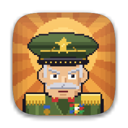

<p align="center">
  
</p>

<h1 align="center">Tenhut</h1>

<p align="center">
  <em>"Ten-hut!" — o comando militar de <strong>Atenção!</strong></em><br>
  Um pomodoro agressivo: um general em pixel art vigia você trabalhar e bloqueia as distrações até a missão acabar.
</p>

[English](README.md)

## O que faz

Você escreve as tarefas da missão e inicia o relógio. Durante todo o bloco de trabalho o general te encara (do seu
ponto de vista, do outro lado da mesa) e os sites que costumam roubar seu tempo ficam bloqueados. Eles voltam nos
intervalos, e para sempre quando **todas as tarefas** estiverem concluídas.

- **Pomodoro agressivo.** 25 / 5 / 15 minutos por padrão, com pausa longa a cada 4 ciclos. Tudo configurável.
- **Um juiz para suas desculpas.** Precisa do YouTube para um tutorial? Explique por quê. O pedido vai para o
  [Claude Code](https://claude.com/claude-code) (`claude -p`) ou para o [Codex](https://github.com/openai/codex)
  (`codex exec`), que decide o que liberar e por quantos minutos. Sem nenhum dos dois, o general te faz esperar.
  O juiz é opcional.
- **Uma campanha, não um cronômetro.** O cenário avança conforme você conclui tarefas: escritório do QG → campo de
  treinamento → linha de frente → desfile da vitória. O general se distrai, cutuca a tela quando você relaxa e
  soca a mesa quando nega um pedido.
- **Câmera (opcional).** Olhar para o celular rende bronca e um minuto a mais no bloco. Olhar para o lado vale se
  houver um monitor ali. Tudo roda localmente; nenhuma imagem sai do seu computador.
- **Patentes.** Pomodoros e missões dão XP, de Recruta a General.
- **Leve.** Cerca de 6% de um núcleo de CPU em foco e ~40 MB de RAM.
- **Português e inglês.** Segue o idioma do sistema; troque em Configurações.

## Instalação

Baixe a versão do seu sistema na [última release](https://github.com/eljonathas/tenhut/releases/latest). Cada uma
tem a versão simples e a `-camera` (maior, com rastreamento de rosto para a vigilância).

| Sistema | Situação | Notas |
|---|---|---|
| **Linux** (x86-64) | Estável | Extraia o `.tar.gz` e rode `./tenhut`. |
| **Windows** (x86-64) | **Beta** | Extraia o zip e rode `tenhut.exe`. Ele pede administrador porque bloquear sites é editar o arquivo hosts. |
| **macOS** (Apple silicon) | **Beta** | Abra o `.dmg` e arraste o `Tenhut.app`. O app não é assinado: clique direito → Abrir na primeira vez, ou `xattr -dr com.apple.quarantine Tenhut.app`. |

### Ativar o bloqueio (Linux e macOS)

Bloquear sites edita o `/etc/hosts`, que exige root. Faça isso uma vez: em **Configurações → instalar bloqueador**
(ou `tenhut --install-helper`). Isso instala um script mínimo, de propriedade do root, e uma regra sudo que permite ao
seu usuário rodar *somente esse script*. O [SECURITY.md](SECURITY.md) explica exatamente o que ele faz. Para remover:
`tenhut --uninstall-helper`. No Windows não há nada para instalar: o app roda como administrador.

### A partir do código

```bash
git clone https://github.com/eljonathas/tenhut && cd tenhut
uv sync                    # ou: uv sync --extra camera
uv run tenhut --dry-run    # --dry-run nunca mexe no arquivo hosts
```

Requer Python 3.12+ e [uv](https://docs.astral.sh/uv/).

## Contribuindo

Relatos de bugs, traduções e pull requests são bem-vindos. Comece pelo [CONTRIBUTING.md](CONTRIBUTING.md).

## Licença

[MIT](LICENSE).
